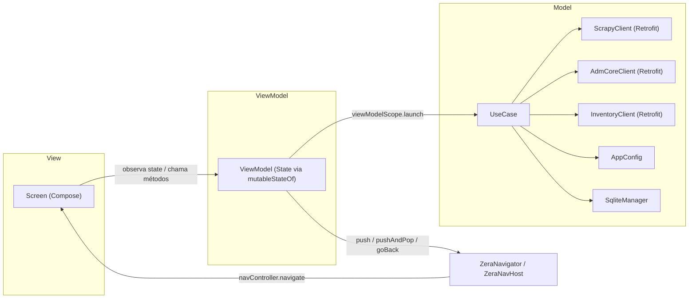

# 01 — Arquitetura

## Visão geral das camadas

O app é um módulo Android único (`:app`) organizado em três camadas, inspiradas em MVVM, mas sem os componentes de um MVVM "canônico" (não há `Repository` nem `UseCase` com interface/contrato — ver abaixo):

- **`model`** — dados e regras de acesso a dados: DTOs de rede (`model/dto`), modelos de domínio/config (`model/entity`), persistência local (`model/local`), acesso remoto via Retrofit (`model/remote`) e casos de uso (`model/usecase`).
- **`viewmodel`** — um `ViewModel` por tela (ou por feature de tela), expõe um `State` imutável via `mutableStateOf` e métodos de intenção (`onEmailChange`, `signIn`, ...). Instancia o(s) `usecase` que precisa diretamente (`val useCase = SingIn()`), sem injeção.
  - Pastas espelhadas de `view/screens/` (`auth/`, `preferences/`, `profile/` e `main/<fluxo>/`) — ver "Organização de módulos/pacotes" abaixo. Ficam soltos na raiz `HomeRoute.kt`, `Splash.kt` e `ZeraViewModel.kt`.
- **`view`** — Jetpack Compose puro: `screens` (telas, uma por rota — `auth/`, `preferences/`, `profile/` e `main/<fluxo>/` para as telas do app em si), `components` (Design System reutilizável — ver [03-catalogo-componentes.md](03-catalogo-componentes.md)), `navigation` (rotas e navegação), `theme` (tokens visuais) e `transition` (transições compartilhadas entre telas).

Não há camada de `Repository` separada: o `usecase` fala diretamente com `AdmCoreClient.<service>`, `ScrapyClient`, `InventoryClient` (e `AiClient` quando for o caso) e com `SqliteManager`. Para o volume atual de regras isso é suficiente; se a lógica de acesso a dados crescer, vale reavaliar (ADR em [08-decisoes-arquiteturais/](08-decisoes-arquiteturais/)).

## Separação entre View e lógica (regra estrita)

A `View` (`Screen`/componente Compose) deve ser **puramente de apresentação**: renderiza o `State` recebido e encaminha eventos de UI (`onClick`, `onValueChange`, ...) para o `ViewModel`. É **proibido implementar lógica na View** — isso inclui:

- decisões condicionais sobre dados de domínio (ex.: `if (usuario.role == "MANAGER")`);
- chamadas a `usecase`, clients Retrofit ou `SqliteManager`;
- validação de dados de negócio (validação puramente de formato de UI, como desabilitar um botão enquanto um campo obrigatório está vazio, é aceitável na View; a regra de negócio em si mora no `ViewModel`);
- disparo de navegação (`ZeraNavigator`) como reação a uma regra — a `View` só invoca `onClick`, é o `ViewModel` quem decide **para onde** navegar e **quando**.

O `ViewModel` é o único responsável por coordenar coleta de dados (inputs do usuário), envio (chamadas a `usecase`), atualização do `State` exibido e, na maioria dos casos, a navegação decorrente dessas ações (ver exemplo em `SingInViewModel.signIn()`, que decide a rota de destino a partir do `role` retornado pela API).

**Exceção conhecida, não um novo padrão a replicar:** `SplashScreen` e `WelcomeScreen` hoje não têm `ViewModel` e chamam `ZeraNavigator` diretamente na `View` (a primeira num `LaunchedEffect` com `delay`, a segunda num `onClick` de botão). Isso funciona porque não há nenhuma decisão de negócio envolvida (é navegação incondicional), mas é uma exceção à regra acima, não motivo para colocar lógica condicional nesse mesmo lugar — qualquer decisão que dependa de dado de domínio deve migrar essas telas para ter `ViewModel` próprio.

## Organização de módulos/pacotes

```
com.zera.android
├── model
│   ├── config/            AppConfig (envs e flags da Scrapy, em memória)
│   ├── dto/               DTOs de rede (@Serializable), por domínio (auth, user, invitation, inventory)
│   ├── entity/            modelos de domínio/config (Environments, UserRole, FlagsRequest)
│   ├── local/             persistência local (SqliteManager, sessão em zera.db)
│   ├── remote/
│   │   ├── client/        AdmCoreClient, ScrapyClient, InventoryClient, AiClient
│   │   └── service/       interfaces Retrofit (AuthService, InventoryService, ScrapyService, ...)
│   └── usecase/           regra de negócio de acesso a dados, por domínio (auth/SingIn, config/Boot, inventory/GetManagerHome, GetItems, GetItemDetails, ...)
├── viewmodel/             um ViewModel por tela/feature, espelhando view/screens (auth/, preferences/, profile/, main/<fluxo>/, ...)
└── view
    ├── screens/           telas Compose: auth/, preferences/, profile/, main/<fluxo>/ + telas soltas (SplashScreen)
    ├── components/        Design System (buttons, cards, containers, inputs, lists, navigation, scaffolds, texts, ...)
    ├── navigation/         Route, NavCommand, ZeraNavigator, ZeraNavHost
    ├── theme/              tokens (cores, tipografia, espaçamento, raio) + ícones
    └── transition/         SharedElement (transições compartilhadas), ScreenAnimation e ScreenAnimationRegistry (animações de entrada/saída de tela)
```

A organização é **por camada primeiro, por domínio depois** (`model/usecase/auth`, `viewmodel/auth`, `view/screens/auth`), e não por feature verticalizada. Ao adicionar um domínio novo, siga esse mesmo padrão de subpasta.

Dentro de `view/screens/` (e, espelhado, em `viewmodel/`):

- `SplashScreen.kt` fica solta na raiz; `auth/` e `preferences/` são domínios próprios, fora do app em si.
- `profile/` — tela de "Perfil", acessada tanto por Gestor quanto por Operário.
- `main/<fluxo>/` — telas do app em si, agrupadas por fluxo: `alerts`, `categories`, `chat`, `employees`, `home`, `indexes`, `items`, `models`, `recycling`, `registration` e `workcentral`.

**Subpasta por perfil:** dentro de `main/<fluxo>/` só existem subpastas `manager/` e `employee/` quando os dois perfis têm telas próprias naquele fluxo — hoje, `main/home/` e `main/items/` em `view/screens/`, e só `main/home/` em `viewmodel/` (o `ItensViewModel` é usado pelas telas dos dois perfis, então `viewmodel/main/items/` não tem subpasta). Telas compartilhadas entre os perfis, ou de um perfil só, ficam soltas na raiz do fluxo (ex.: `main/models/ModelsScreen.kt`, usada pelos dois perfis; `main/workcentral/WorkingCentralScreen.kt`, só do Operário). Não crie pastas `shared/`, nem `manager/`/`employee/` fora de um fluxo.

## Fluxo de dados entre camadas

Fluxo típico de uma ação de usuário (exemplo: login, ver [viewmodel/auth/SignIn.kt](../app/src/main/java/com/zera/android/viewmodel/auth/SignIn.kt)):

1. A `Screen` (Compose) observa o `state` do `ViewModel` (`val state by viewModel.state`) e chama seus métodos em resposta a eventos de UI (`onClick`, `onValueChange`).
2. O `ViewModel` atualiza seu `State` imediatamente quando cabível (ex.: `isLoading = true`) e lança uma `viewModelScope.launch` para chamar o `usecase`.
3. O `usecase` chama `AdmCoreClient.<service>`, `ScrapyClient`, `InventoryClient` ou `AiClient` e, quando necessário, grava/lê `SqliteManager` / `AppConfig`.
4. O resultado (sucesso ou exceção) volta ao `ViewModel`, que atualiza o `State` e, se for o caso, dispara uma navegação via `ZeraNavigator`.
5. A `Screen` recompõe automaticamente a partir do novo `State` (Compose reage a `State` via `getValue`/`by`).

O `State` de cada tela é uma `data class` imutável (`copy()` a cada mudança) guardada em `mutableStateOf` — não `StateFlow`/`MutableStateFlow`. Não há camada de mapeamento DTO → modelo de domínio: os `ViewModels` de auth usam o DTO de forma transiente (ex.: `SelfUserResponseDTO` só para decidir a rota). Home e indicadores mapeiam o DTO de inventário para campos de UI no próprio `ViewModel` (`ManagerHomeState`, `IndexesState`), sem classe de domínio intermediária. Ver [04-modelo-de-dados.md](04-modelo-de-dados.md).

## Injeção de dependência

**Não há framework de injeção de dependência** (nem Hilt, nem Koin, nem injeção manual via construtor). As dependências compartilhadas são `object` (singletons de linguagem Kotlin):

- `ScrapyClient` — Retrofit da Scrapy (`POST /v1/boot` e `POST /v1/flags`), header `apikey`. Sobe na splash, antes dos outros clients. Contrato em [contrato-scrapy/contrato-scrapy-api.md](contrato-scrapy/contrato-scrapy-api.md).
- `AdmCoreClient` — Retrofit do adm-core em `init(environments)` (`ms-adm-core-url`), header `apiKey`, JWT da sessão, `TokenRefreshAuthenticator` no 401. Expõe auth, users, invitations, notifications, places, etc.
- `InventoryClient` — Retrofit do `ms-inventory` (`ms-inventory-url`). Headers `apiKey`, `Authorization: Bearer` e `X-Unit-Id`. Contrato em [contrato-dashboard/contexto.md](contrato-dashboard/contexto.md) e [contrato-pdi/](contrato-pdi/).
- `AppConfig` — `environments` e `flags` em memória depois do boot / `LoadFlags`.
- `SqliteManager` — sessão (`zera.db`). Init em `ZeraApp.onCreate` (e de novo em `MainActivity` se a Activity subir primeiro em teste).
- `ZeraNavigator` — ponto único de comandos de navegação (ver seção seguinte).

`ViewModels` instanciam seus `usecase`s diretamente como propriedade (`val useCase = SingIn()`) e são obtidos nas `Screens` via o factory padrão do Compose (`viewModel()`), sem `Factory` customizada. Essa combinação funciona hoje porque os `usecase`s não têm dependências configuráveis além dos próprios singletons — se isso mudar (ex.: necessidade de trocar implementação em teste), vale considerar introduzir um framework de DI e registrar a decisão como ADR.

## Navegação

A navegação usa **Jetpack Navigation Compose** com rotas tipadas (`sealed interface Route`, `@Serializable`), mas o disparo de navegação **não é feito diretamente pelas telas** — é centralizado em `ZeraNavigator` (`view/navigation/ZeraNavigator.kt`), um singleton que expõe um `Flow<NavCommand>` (`Channel` por baixo) consumido uma única vez em `ZeraNavHost`.

- `ZeraNavigator.push(route, animation)` — navega mantendo a pilha (`Navigate`).
- `ZeraNavigator.pushAndPop(route, popCount, animation)` — substitui a tela atual pela nova (`PushAndPop`), usado por exemplo ao sair da Splash ou redirecionar após o login.
- `ZeraNavigator.pushAndPopAll(route, animation)` — limpa toda a pilha de navegação, deixando só a nova rota (`PushAndPopAll`).
- `ZeraNavigator.goBack()` — volta uma tela (`GoBack`); não recebe animação, ela é derivada da tela removida (ver abaixo).
- `ZeraNavigator.navigationStatus(true|false)` — habilita ou bloqueia globalmente os quatro tipos de navegação. `false` impede navegação programática, botão voltar da interface e botão voltar nativo/gestual; `true` restaura o comportamento normal.

O parâmetro `animation` é um `ScreenAnimation` e é opcional (padrão `Fade`).

Operações assíncronas que não podem ser interrompidas por navegação devem chamar `navigationStatus(false)` antes de iniciar o carregamento e restaurar `navigationStatus(true)` em todo encerramento da operação (`sucesso`, `erro` e `cancelamento`). O estado também deve ser restaurado pelo ciclo de vida da tela/ViewModel para evitar bloqueio permanente. `ZeraNavHost` possui uma defesa adicional e o Android `BackHandler` consome o gesto de voltar enquanto a navegação estiver desabilitada.

Qualquer camada (tipicamente o `ViewModel`, mas também `Screens` simples como `WelcomeScreen`) pode chamar `ZeraNavigator` diretamente, sem precisar de referência ao `NavHostController`. Isso desacopla `ViewModels` de Compose/Navigation-Compose, mas também significa que a navegação não é unit-testável isoladamente sem observar o `Flow` de comandos.

### Animações de tela

A animação de entrada/saída é escolhida por quem empilha a tela (`ZeraNavigator.push(Route.X, ScreenAnimation.SlideVertical)`), não fixada na rota. Os tipos disponíveis são `Fade`, `SlideHorizontal`, `SlideVertical` e `None` (`view/transition/ScreenAnimation.kt`); cada um define quatro transições: `enter()` (tela nova entrando), `exit()` (tela anterior saindo), `popEnter()` (tela anterior voltando) e `popExit()` (tela removida saindo).

O `ScreenAnimationRegistry` (`view/transition/ScreenAnimationRegistry.kt`), criado em `ZeraNavHost`, associa a animação ao `id` de cada `NavBackStackEntry`:

- `prepare(animation, navController)` roda antes de cada `navigate`: remove do mapa as telas que já saíram da pilha e guarda a animação como pendente.
- `of(entry)` roda nas lambdas de transição do `NavHost`: se a tela já está no mapa, devolve a animação registrada; se é nova, grava a pendente (ou `Fade`) e a limpa.

O `NavHost` usa `of(targetState)` em `enterTransition`/`exitTransition` e `of(initialState)` em `popEnterTransition`/`popExitTransition`. Assim o "voltar" (inclusive o gesto/botão do sistema, que não passa pelo `ZeraNavigator`) reverte a animação com que a tela foi empilhada. Limitações: se um `navigate` não gerar transição (ex.: `launchSingleTop` na mesma tela), a animação pendente vaza para a próxima navegação; e o mapa vive em memória, então após process death as telas restauradas usam `Fade`. Ver [ADR-0002](08-decisoes-arquiteturais/0002-animacao-de-tela-por-comando-de-navegacao.md).

### Elementos compartilhados

O app usa `SharedTransitionLayout` (API experimental do Compose) para animar elementos compartilhados entre telas (hoje, o logo e a `ManagerBottomNavBar` — ver [view/transition/SharedElement.kt](../app/src/main/java/com/zera/android/view/transition/SharedElement.kt)); os escopos necessários (`LocalSharedTransitionScope`, `LocalAnimatedVisibilityScope`) são providos em `ZeraNavHost` e consumidos pelo modifier `Modifier.sharedTransition(key)`. Uma tela só participa de um shared element se o seu `composable<>` estiver envolvido em `CompositionLocalProvider(LocalAnimatedVisibilityScope provides this)`; hoje isso vale para as telas de auth (`Splash`, `Welcome`, `SignIn`, `SignUp`) e para as quatro telas do `ManagerScaffold` (`ManagerHome`, `Employees`, `Indexes`, `Itens`).

## Tratamento de erros

Falha de rede e falha de uma chamada são tratadas de formas diferentes. A regra completa e os cenários estão em [07-especificacoes/telas-de-erro.md](07-especificacoes/telas-de-erro.md).

| Situação | Como o usuário vê |
|---|---|
| Sem conexão (`UnknownHostException`, `ConnectException`, `SocketTimeoutException`), na abertura ou durante o uso | Tela cheia `ConnectionError`, uma vez só |
| Falha no boot (5xx ou configuração inválida) | Tela cheia `FatalError`, que fecha o app |
| Falha ao carregar ou enviar (400, 409, 422, 5xx) | `ErrorFeedbackPopup` ("Algo deu errado" + descrição simples) |
| Validação de campo, login, cadastro e recuperação de senha | Inline, embaixo do campo ou do formulário |

- **Detecção de conexão:** `Throwable.isConnectionError()` (`model/remote/client/util.kt`) olha também as causas da exceção. `ConnectionErrorInterceptor` está em todos os clients HTTP (`AdmCoreClient` principal e de refresh, `InventoryClient`, `AiClient`, `ScrapyClient`, `SupabaseStorage`): ao falhar por conexão libera a navegação (`navigationStatus(true)`), faz `push(Route.ConnectionError())` e relança a exceção, para o `catch` de cada tela continuar rodando. `ConnectionErrorGate` garante uma tela só mesmo com várias chamadas falhando juntas; a trava é liberada no `onCleared` da `ConnectionErrorViewModel`.
- **Splash:** `SplashViewModel` suprime o interceptor (`gate.suppress(true)`) enquanto roda o boot e o restore, e navega ela mesma para `ConnectionError(fromBoot = true)` ou `FatalError`. Falha de conexão ao restaurar a sessão não apaga o login salvo; só 401/403 apagam.
- **`ConnectionError`:** "Tentar novamente" checa a conexão antes de sair (`NetworkStatus.isOnline`, permissão `ACCESS_NETWORK_STATE`). Online, volta para a Splash (`fromBoot = true`) ou para a tela anterior (`fromBoot = false`); offline, a tela continua. O voltar do sistema faz o mesmo quando `fromBoot = false`.
- **Nos `ViewModel`s:** o `catch` guarda no `State` uma descrição escrita para o usuário, nunca `e.message`. Os helpers estão em `viewmodel/ErrorDescription.kt`: `errorDescription(error, texto)` devolve `null` para falta de conexão (a tela cheia já aparece, sem popup), `loadErrorDescription("os itens")` monta o texto padrão de carga e `appMessageOrFallback(error, texto)` mantém só as mensagens que os casos de uso escrevem para o usuário (`IllegalStateException`/`IllegalArgumentException`). Cada `ViewModel` expõe `onErrorDismiss()`, que limpa o erro, e a tela compõe `state.errorMessage?.let { ErrorFeedbackPopup(...) }`.
- **Listas:** quando a carga falha, a lista fica vazia sem o texto "Nenhum ... encontrado" (campo `loadFailed` no `State`), e não há botão de tentar de novo. A paginação (`LoadMoreEffect`) só pede a próxima página quando o usuário chega ao fim, então uma página que falhou não entra em loop.
- **Fora do que foi feito:** handler de crash (`Thread.setDefaultUncaughtExceptionHandler`) reabrindo em `FatalError`, e o mapa de recicladoras próximas e a bolha de erro do chat, que mantêm o feedback próprio.

## Concorrência (coroutines)

`ViewModels` usam `viewModelScope.launch` para chamadas suspensas (rede). Não há uso de `Flow`/`StateFlow` para estado reativo — só para o canal de comandos de navegação (`ZeraNavigator.commands`). Não há dispatchers customizados explícitos; as chamadas Retrofit (`suspend fun`) já fazem I/O fora da main thread pelo próprio Retrofit/OkHttp.

## Diagrama (mermaid)


